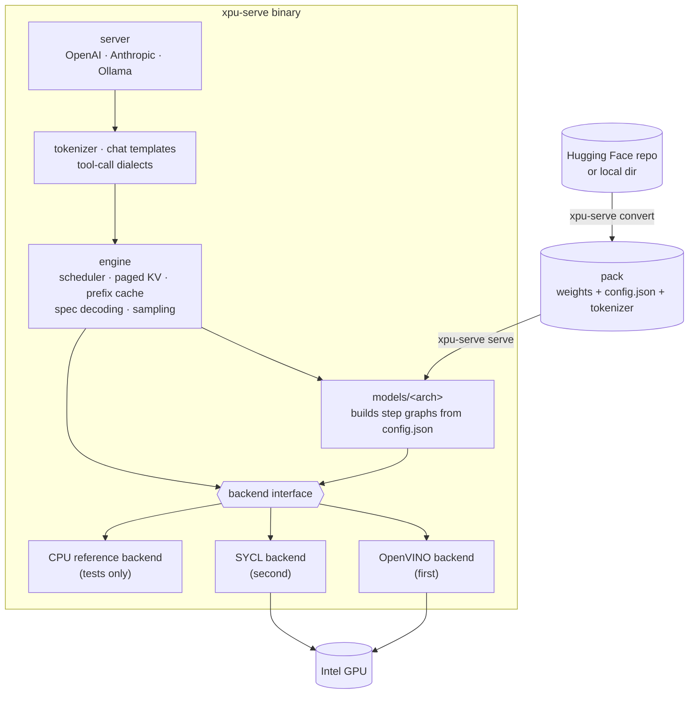
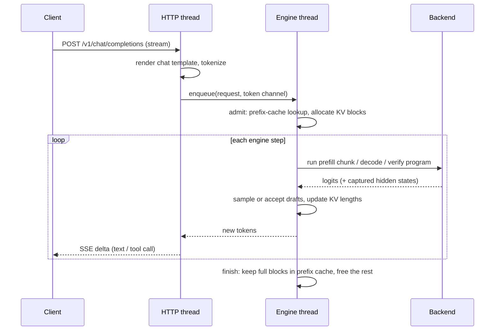
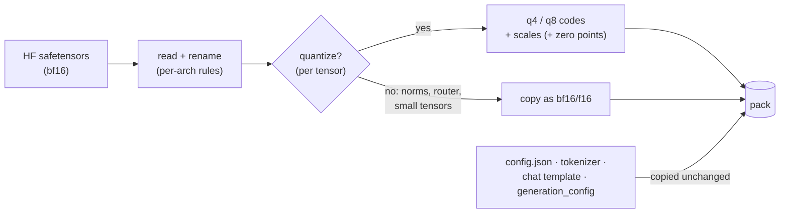
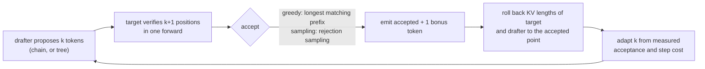
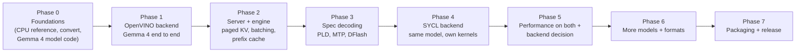

# xpu-serve: design

Status: **draft v0.1, for review** · 2026-11-06 · Owner: v1k22

> **Update 2026-11-07:** after the first comparison, SYCL became the GPU backend
> ([decision 0007](docs/decisions/0007-sycl-backend.md)) and the OpenVINO backend was removed from the code
> ([decision 0008](docs/decisions/0008-remove-openvino.md)). The sections below that describe the OpenVINO backend
> and the two-backend plan are kept as design history; PROJECT.md describes the code as it is.

xpu-serve runs LLMs on Intel GPUs. It is one repo and one binary, with one command to convert a model and one to
serve it. The model code, the engine (KV cache, scheduling, speculative decoding), the converter and the server all
live here. The backend that runs the math sits behind a small interface.

**Backend order: OpenVINO first, then SYCL.** OpenVINO is the fastest way to a working end-to-end model. SYCL
comes second and gives full control over every kernel. Both pass the same tests. **We will choose one as the main
backend only after many experiments** comparing them on the same model, packs and engine ([section 8.2](#82-how-we-choose-the-main-backend)).

```bash
xpu-serve convert ~/models/gemma-4-26B-A4B-it --quant q4 --out gemma4-26b-q4
xpu-serve serve gemma4-26b-q4            # OpenAI-compatible server on http://127.0.0.1:8080
```

---

## Contents

1. [Problem](#1-problem)
2. [Goals and non-goals](#2-goals-and-non-goals)
3. [Principles](#3-principles)
4. [Architecture](#4-architecture)
5. [Command line](#5-command-line)
6. [Packs and `convert`](#6-packs-and-convert)
7. [Model code](#7-model-code)
8. [Backends](#8-backends)
9. [Engine](#9-engine)
10. [Speculative decoding](#10-speculative-decoding)
11. [Tokenizer and chat templates](#11-tokenizer-and-chat-templates)
12. [Server and API](#12-server-and-api)
13. [Accuracy and testing](#13-accuracy-and-testing)
14. [Performance method](#14-performance-method)
15. [Repo layout](#15-repo-layout)
16. [Dependencies and licensing](#16-dependencies-and-licensing)
17. [Roadmap](#17-roadmap)
18. [Risks](#18-risks)
19. [Open questions for review](#19-open-questions-for-review)
- [Appendix A: Gemma 4 26B-A4B facts and decode math](#appendix-a-gemma-4-26b-a4b-facts-and-decode-math)
- [Appendix B: What existing projects do](#appendix-b-what-existing-projects-do)
- [Appendix C: Glossary](#appendix-c-glossary)

---

## 1. Problem

Today, adding one model feature to the OpenVINO stack touches four projects. Speculative decoding for Gemma 4 (an MTP
drafter and DFlash) needed:

| Change | Project | Why that project |
|---|---|---|
| Export fix | optimum-intel | The graph is made by tracing the PyTorch model; a new output or layout means a new trace |
| GQA KV split cache for PagedAttention | openvino.genai | The pipeline owns the KV cache and the spec-decode loop |
| Missing GPU kernels | openvino | The runtime owns the kernels and the graph rewrites (SDPA → PagedAttention) |
| Spec-decoding flag | OVMS | The server owns the user-facing switches |

Each project has its own review, CI, release cycle and test setup. One feature means four PRs, four reviews and four
releases that have to line up. The root cause is structural: **knowledge of one model is split across four owners**.
The tracer and the graph pattern matchers both have to "understand" Gemma 4, and they live in different repos.

xpu-serve puts everything that knows about a model in one place.

## 2. Goals and non-goals

### Goals (v1)

1. **One repo, one binary.** `xpu-serve convert` and `xpu-serve serve`. No Python at runtime or in convert.
2. **One PR per feature.** A new model, a new spec-decoding method or a new KV layout lands as one PR in this repo.
3. **Gemma 4 26B-A4B first**, with long-context decode (32k and 64k) on:
   - Panther Lake iGPU (Arc B390, Xe3, shared LPDDR5x memory)
   - Arc Pro B60 (Battlemage, Xe2, 24 GB GDDR6)
4. **Speculative decoding built in:** prompt lookup (n-gram), the Gemma 4 MTP assistant drafter, and DFlash.
5. **Accuracy proven by tests**, not by eye: bf16 parity against Hugging Face, and quantized packs measured against bf16.
6. **Speed at least equal to OpenVINO GenAI** on the same device and settings, then better.
7. **Two backends, same tests:** OpenVINO first, then SYCL. The main backend is chosen after experiments, not now.
8. **OpenAI-compatible server** with streaming and tool calls; Anthropic and Ollama APIs later.

### Non-goals (v1)

- Training or fine-tuning.
- NPU, CPU serving as a product (a CPU *reference* backend exists for tests only), multi-GPU / tensor parallel.
- Non-Intel GPUs. A Vulkan backend may come later; it is not planned.
- Vision, audio, image or video generation (the design leaves room; not in v1).
- Python bindings.
- Windows in the first milestones (Linux first; Windows in the packaging phase).

## 3. Principles

Every design choice and every PR is judged against these.

| # | Principle | What it means in practice |
|---|---|---|
| P1 | **One feature, one PR, one repo** | If a feature needs a change outside this repo, the design is wrong; fix the design |
| P2 | **A pack changes only when its weights change** | Graph, KV layout and spec-decode changes ship as a new binary; existing packs keep working |
| P3 | **A model's quirks live in its folder** | `models/gemma4/` holds everything Gemma 4 specific: config parsing, graph, drafter wiring, tool-call dialect, notes |
| P4 | **The engine owns state; backends execute** | KV memory, block tables, scheduling and spec decoding are engine code; a backend runs a step graph over memory the engine gives it |
| P5 | **Backends are swappable and tested the same way** | A missing backend capability is declared and refused by name, never silently slow or wrong |
| P6 | **Every kernel has a reference; every model has a parity test** | No kernel or model merges without them |
| P7 | **Measure first; every number names its setup** | Device, driver, commit, prompt set, context, run count |
| P8 | **No Python in the product** | Python is allowed only in `tests/` to produce reference fixtures from Hugging Face |
| P9 | **Third-party code is pinned; fixes are patches here** | A backend bug is fixed with a patch file in `third_party/patches/`, applied by our build, and offered upstream later. We never wait on another project's review |
| P10 | **Correct and simple first** | Batch 1 before batching, chain drafts before tree drafts, eager before graph replay |

## 4. Architecture



### 4.1 Layers and who owns what

| Layer | Owns | Does not own |
|---|---|---|
| `convert/` | Download, read safetensors, quantize, write a pack | Any model graph |
| `models/<arch>/` | Config parsing, the forward graph, which tensors to quantize, drafter wiring, quirks | Memory, scheduling, kernels |
| `engine/` | Requests, slots, KV pools and block tables, prefix cache, spec-decode loop, sampling, memory budget | How an op is computed |
| `graph/` | The in-memory step graph and its builder API | Execution |
| `backend/<name>/` | Turning a step graph into device work; weight upload; device memory | Any model or request logic |
| `server/`, `chat/`, `tokenizer/` | HTTP, API formats, templates, tool-call parsing, tokenization | Inference |

### 4.2 A request, end to end



A single **engine thread** is the only code that talks to the device. HTTP threads never touch the backend. That
removes a whole class of races and keeps per-step overhead predictable.

## 5. Command line

```text
xpu-serve convert <dir> --out DIR [--quant q4|q8] [--group 32|64|128] [--q8 name,...]
                  [--keep REGEX ...] [--revision REV] [--with-drafter <hf-id | dir>]
xpu-serve serve   <pack | name> [--backend openvino|sycl] [--device GPU.0] [--host 127.0.0.1] [--port 8080]
                  [--ctx 65536] [--max-seqs 4] [--kv-dtype auto|i8]
                  [--spec auto|off|pld|mtp|dflash] [--spec-k N]
xpu-serve run     <pack | name>     # serve + chat in the terminal
xpu-serve bench   <pack | name> [--ctx 1k,32k,64k] [--gen 256] [--spec ...]
xpu-serve check   <pack | name>     # validate a pack, print its memory bill for a device
xpu-serve info                      # devices, drivers, compiled-in backends
```

- A bare name resolves under `~/.xpu-serve/models/<name>`.
- `--spec auto` (default) turns on the drafter shipped inside the pack, if any. Batch 1 with no drafter falls back to
  prompt lookup.
- Every flag has one meaning on every backend. A flag a backend cannot honour is refused at start with the reason
  (P5).

## 6. Packs and `convert`

### 6.1 What convert does and does not do

`convert` is **file to file**. It reads Hugging Face weights and writes a pack. It never traces or exports a graph,
and it never imports PyTorch.



Steps:

1. **Fetch** from Hugging Face (resumable, `HF_TOKEN` honoured, revision pinned) or read a local directory.
2. **Read** `config.json`, pick the architecture by `model_type`. An unknown architecture is refused by name.
3. **Plan**: the model folder says which tensors are quantized and which stay in high precision (norms, router,
   small vectors), and any tensor renames.
4. **Quantize** each tensor (round-to-nearest in v1; data-aware methods later, see 6.5).
5. **Write** sharded safetensors (≤ 4 GB per shard), the index, the manifest, and copy the tokenizer, chat template and
   generation config unchanged.
6. **Drafter** (optional): `--with-drafter` converts the drafter into `drafters/<kind>/` inside the same pack.

### 6.2 Pack layout

```text
gemma4-26b-q4/
├── config.json                      # copied from HF, unchanged
├── generation_config.json
├── tokenizer.json  tokenizer_config.json  chat_template.jinja
├── xpu_pack.json                    # manifest (below)
├── model-00001-of-00004.safetensors
├── ...
├── model.safetensors.index.json
└── drafters/
    ├── mtp/                         # e.g. google/gemma-4-26B-A4B-it-assistant
    └── dflash/
```

### 6.3 Weight formats

Each quantized tensor is stored as plain safetensors tensors next to each other:

| Tensor | dtype | Shape | Meaning |
|---|---|---|---|
| `X.weight` | `I8` (q8) / `U8` (q4) | `[out, in]` / `[out, in / 2]` | Codes, row-major, `in` contiguous; q4: two per byte, low nibble = even column |
| `X.weight.scales` | `F16` | `[out, in / group]` | One scale per group |
| `X.weight.biases` | `F16` | `[out, in / group]` | q4 only: one bias per group |

Formats (as built, 2026-11-07):

| Format | Dequant | Notes |
|---|---|---|
| `bf16`, `f16` | as is | Quality reference; tensors that are not quantized keep their checkpoint dtype |
| `q8` | `w = s · q`, `q ∈ [-127, 127]` | Symmetric, round to nearest, `s = max|w| / 127` per group |
| `q4` | `w = s · q + b`, `q ∈ [0, 15]` | Affine (MLX layout), round to nearest, `b = min`, `s = (max - min) / 15` per group |

Groups of 32, 64 (default) or 128 columns. Codes are chosen against the f16-rounded scale and bias, so dequantization
reproduces exactly what the rounding picked. q4 uses a float bias rather than an integer zero point: the integer form
only mattered for OpenVINO's compressed matmul, and a float bias fits round-to-nearest and AWQ better and matches MLX
packs. `convert` lets the model's step graph decide what to quantize: weights read as matmul weights take the
requested format, gather tables (and so a tied LM head) take q8, matrices under 1M elements and everything else stay
as they are, and `--q8 name,...` keeps chosen matmul weights at q8.

**The format of every tensor is written down explicitly** in the manifest. Nothing is inferred from shapes. Guessing
bits or group size from tensor geometry is a known source of silent bugs.

### 6.4 Manifest (`xpu_pack.json`)

```json
{
  "pack_version": 1,
  "converter": "xpu-serve 0.4.0",
  "source": { "name": "gemma-4-26B-A4B-it", "model_type": "gemma4" },
  "quant": { "format": "q4", "group": 64, "method": "rtn", "min_elements": 1048576, "q8_names": [] },
  "tensors": {
    "model.language_model.layers.0.self_attn.q_proj.weight": { "format": "q4", "group": 64, "shape": [2048, 1536] }
  },
}
```

Only quantized tensors are listed; every other tensor is a plain safetensors tensor. The manifest makes a pack
reproducible: same source files + same converter version + same options = same bytes (recording the source revision
and file hashes, and drafters, are still to come).

### 6.5 Quantization quality

- Round to nearest per group by default (q4 in groups of 32, q8 in groups of 64); embedding tables and tied LM heads
  at q8.
- `--method awq` for q4: AWQ-style (built 2026-11-07). `convert` copies the model's graph with each quantized matmul's input as
  an extra output, runs calibration text through **our own engine** (GPU or cpu-ref), and keeps each input channel's
  mean square. Per weight it searches column scales `s = rms^alpha` and a per-group clip, minimizing the
  activation-weighted error, and stores `1 / s` as `.input_scales`, which kernels apply to `x`; nothing is folded into
  other weights, so no model needs AWQ code. Results: docs/decisions/0009.
- Later: chat-formatted calibration (Gemma 4 drifted into its thinking channel when calibrated on plain prose),
  GPTQ, AWQ against the full activation covariance, larger calibration sets.
- Quality gates for every default preset are in [section 13](#13-accuracy-and-testing).

## 7. Model code

### 7.1 Why there is no exported IR

The engine already knows each architecture because the forward pass is **written as code** in `models/<arch>/`, the
way llama.cpp and mlx-serve do it. At load time:

1. read `config.json` and its `model_type`
2. pick the matching model folder
3. build the step graphs with the sizes from the config
4. bind the weights from the pack

One code path serves every size of a family: Gemma 4 E2B, E4B, 12B, 26B-A4B and 31B differ only in numbers in
`config.json` and in the weight files.

**The step graph is not the IR we removed.** It is an in-memory description of one engine step (prefill, decode,
verify, draft), built from our own code at load time, never traced from PyTorch and never saved as a model file. If
we change it, we rebuild the binary. Packs are unaffected (P2).

### 7.2 What a model folder contains

```text
models/gemma4/
├── README.md        # architecture notes, quirks, reference links, which packs are tested
├── config.cpp       # parse config.json (text_config first, then root), validate, compute the memory bill
├── convert.cpp      # quantization plan and tensor renames for convert
├── model.cpp        # forward graph: prefill / decode / verify
├── drafter.cpp      # MTP assistant and DFlash wiring (which hidden states to capture, shared KV)
├── chat.cpp         # tool-call dialect and reasoning channel selection
└── tests/           # tiny-model parity fixtures (see 13.2)
```

Blocks shared by many models (attention, GeGLU/SwiGLU MLP, MoE, RMSNorm, RoPE variants) live in `models/common/`.
A new model should mostly be config parsing plus the parts that make it different.

### 7.3 The builder API (sketch)

Illustrative only. The exact Gemma 4 norm placement, layer scalars and the router input are pinned by the parity test,
not by this sketch.

```cpp
// models/gemma4/model.cpp (sketch)
Tensor Gemma4::forward(GraphBuilder& g, const StepInputs& in) {
    Tensor h = g.mul(g.embed(w.embed, in.tokens), g.scalar(cfg.embed_scale));
    for (int i = 0; i < cfg.n_layers; ++i) {
        const Layer& L = w.layers[i];
        const AttnKind kind = cfg.attn_kind[i];                  // sliding (W=1024) or global
        Tensor a = attention(g, L, kind, g.rms_norm(h, L.input_norm), in);
        h = g.add(h, g.rms_norm(a, L.post_attn_norm));
        Tensor dense  = mlp_geglu(g, L.mlp, g.rms_norm(h, L.pre_ff_norm));
        Tensor routed = moe(g, L.moe, /*router reads*/ h, /*experts read*/ g.rms_norm(h, L.pre_ff_norm_2));
        h = g.add(h, combine(g, L, dense, routed));
        if (in.capture_layer(i)) g.output(capture_name(i), h);  // hidden states for DFlash
    }
    Tensor logits = g.matmul(g.rms_norm(h, w.final_norm), w.embed); // tied LM head
    return g.softcap(logits, cfg.final_logit_softcap);
}
```

`attention()` calls one op, `g.paged_attention(...)`. That op writes the new K/V into the engine's KV pool and reads
the history through the block table. There is nothing to pattern-match later: attention is paged from the start.

### 7.4 Gemma 4 specifics that live in `models/gemma4/`

| Quirk | Effect on code |
|---|---|
| Sliding layers (window 1024, 8 KV heads × head dim 256) and global layers (2 KV heads × head dim 512) | Two KV pools with different head dims (see 9.2) |
| Global layers have `attention_k_eq_v`: no `v_proj`, V comes from the K projection | Graph builds V from K; the KV layout may store it once (Phase 5 experiment) |
| Attention scale 1.0; q/k norms carry the scale; partial rotary on global layers, a local RoPE base on sliding ones | Attributes of `rope` and `paged_attention` |
| MoE (128 experts, top 8) plus a dense MLP in each layer; the router reads the residual, the experts read a separate norm | `moe()` call with two inputs |
| Tied embeddings, very large vocab (262,144), final logit softcap | LM head = embedding table; only the needed rows of logits are computed |
| MTP assistant drafter: 4 layers, hidden 1024, **reads the target's KV**, centroid LM head | `drafter.cpp` + KV pool sharing (10.3) |
| Gemma tool-call and reasoning format | `chat.cpp` selects the dialect |

E2B/E4B add per-layer embeddings (PLE) and a KV-shared tail. They come after 26B-A4B in the same folder.

## 8. Backends

### 8.1 Backend order: OpenVINO first, then SYCL

**Our preference is clear: build OpenVINO first, then SYCL.** OpenVINO gets Gemma 4 working end to end soonest,
because its GPU kernels already exist, and it gives the speed baseline. SYCL work starts once the OpenVINO path works
end to end (Phases 1 to 3). Neither is declared the winner up front.

| | OpenVINO | SYCL |
|---|---|---|
| Role | **First**: fastest way to a working Gemma 4, and the speed baseline | **Second**: full control over every kernel |
| Matmul, attention | OpenVINO GPU plugin kernels (compressed matmul, PagedAttention) | Ours for decode (int4 GEMV, MoE, paged attention); oneDNN for large prefill GEMMs |
| New kernel | Custom op via OpenVINO's extension API; otherwise a patch in `third_party/patches/openvino/` | Written here |
| Graph compile | OpenVINO compiles the whole step graph | Light: memory plan + kernel choice + optional graph replay |
| What it proves | The engine, model code and convert are right, and our overhead is small (same kernels as OpenVINO GenAI) | We can beat the baseline and add features (tree attention, KV layouts) without anyone's review |

Both backends run the same packs, the same model code and the same engine, and pass the same tests. That allows a
clean **per-op A/B**: same graph, same inputs, two backends.

### 8.2 How we choose the main backend

The choice is made **after many experiments**, once both backends run Gemma 4 26B-A4B end to end. It is recorded in
`docs/decisions/` with the numbers. Criteria, in order:

1. **Ownership:** can a new feature (tree-mask verify, a new KV layout, a new drafter) be added fully inside this repo,
   without waiting on another project?
2. **Decode speed** at 32k and 64k, batch 1, with and without speculative decoding, on Arc B390 and Arc Pro B60, as a
   share of the roofline (Appendix A).
3. **Accuracy:** both pass the same contracts and parity tests; any difference is explained.
4. **Prefill speed and time to first token.**
5. **Load and compile time,** memory overhead, binary and runtime size, driver requirements, Windows support.

The other backend stays buildable as long as it costs little to keep, so the per-op A/B stays available.

### 8.3 The interface

```cpp
// backend/backend.h (sketch)
struct BackendInfo {
    std::string name;            // "openvino", "sycl", "cpu-ref"
    DeviceInfo  device;          // name, memory, measured bandwidth, iGPU/dGPU
    Capabilities caps;           // see 8.5
};

class Program {                  // one compiled step graph
public:
    virtual ~Program() = default;
    virtual void run(const StepBindings& b) = 0;   // token ids, positions, block tables, lengths -> logits, hidden
};

class Backend {
public:
    virtual ~Backend() = default;
    virtual BackendInfo info() const = 0;
    virtual WeightHandle upload(const PackTensor& t) = 0;          // may repack into a device-friendly layout
    virtual KvPoolHandle make_kv_pool(const KvPoolSpec& spec) = 0;  // device memory the engine owns
    virtual std::unique_ptr<Program> compile(const Graph& g, const CompileHints& h) = 0;
};
```

- **OpenVINO:** `compile` turns the step graph into an `ov::Model` with dynamic token dimensions and calls
  `compile_model` (with the model cache enabled). `run` binds tensors and calls `infer`.
- **SYCL:** `compile` sorts the graph, plans activation memory (buffers reused by liveness), picks a kernel per node,
  and optionally records a SYCL command graph per shape bucket. `run` enqueues or replays it.
- **CPU reference:** `compile` sorts the graph; `run` interprets it in fp32/fp64. Slow and simple, on purpose.

### 8.4 Op set (v1)

Enough for Gemma 4, Qwen 3 and Llama 3. Every op has a CPU reference implementation and a contract test (13.1).

| Op | Notes |
|---|---|
| `embed(table, ids)` | Gathers rows; dequantizes rows of a quantized table |
| `matmul(x, W[, bias])` | `W` in any pack format (6.3); fp32 accumulation |
| `moe(x_router, x_experts, router, bank, top_k, ...)` | Routing (softmax/sigmoid, renorm, per-expert scale) + grouped expert GEMMs + activation |
| `rms_norm`, `layer_norm` | Optional `+1` weight offset; optional fused residual add |
| `rope(x, positions, ...)` | Full or partial, base per layer kind, scaling variants (linear, llama3, YaRN) |
| `paged_attention(q, k, v, pool, meta, ...)` | Writes new K/V, reads history; masks: causal, sliding window, tree; GQA; softcap; sinks |
| `add`, `mul`, `softcap`, `gelu_tanh`, `silu`, `geglu`, `swiglu` | Elementwise |
| `reshape`, `transpose`, `slice`, `concat` | Views where possible |
| `select_rows(x, idx)` | Computes logits only for the rows we sample from |
| `argmax`, `topk` | Device-side sampling helpers |

### 8.5 Capabilities

A backend declares what it supports. The engine adapts (for example chain drafts instead of tree drafts) or refuses
the flag by name. It never silently falls back to something slow or wrong.

| Capability | CPU ref | OpenVINO (expected; verified in Phase 1) | SYCL (planned; verified in Phase 4) |
|---|---|---|---|
| Paged attention, causal + sliding | yes | yes (PagedAttention op) | yes |
| Multi-token verify (chain) | yes | yes | yes |
| Tree-mask verify | yes | no, unless added as a custom op | yes |
| Hidden-state capture (DFlash) | yes | yes (extra model outputs) | yes |
| int8 KV cache | yes | yes (KV cache precision) | yes |
| K=V stored once (Gemma 4 global layers) | yes | probably not | yes |
| Graph replay for decode | n/a | handled inside OpenVINO | yes (SYCL command graphs) |

### 8.6 OpenVINO backend details

- **No IR files, no optimum-intel, no GenAI, no OVMS.** Only the OpenVINO runtime as a library. The `ov::Model` is
  built in C++ from the step graph with standard opset ops.
- **Weights** are `ov::op::v0::Constant`s that point at the memory-mapped safetensors (no copy on the host). Quantized
  weights use the standard decompression pattern `Convert → Subtract(zero point) → Multiply(scale) → MatMul`, which
  the GPU plugin fuses into its compressed matmul.
- **KV cache:** our engine allocates the cache tensors (as device memory through OpenVINO's remote context) and
  passes the block tables and lengths the PagedAttention op expects. The engine owns the layout, OpenVINO only
  reads and writes it. That is how the MTP drafter can read the target's KV: it is the same tensor passed to two
  compiled programs.
- **Version pin:** a released OpenVINO when it has everything Gemma 4 needs. Until the Gemma 4 fixes are released,
  `scripts/build-openvino.sh` builds a pinned OpenVINO commit plus `third_party/patches/openvino/*.patch`. This is P9:
  the patch is ours, and it goes away when upstream catches up.
- **Adapter:** the PagedAttention input list has changed between OpenVINO versions. All of that lives in one file,
  `backend/openvino/paged_attention.cpp`, tied to the pinned version.

### 8.7 SYCL backend details

- **Decode kernels are ours:** int4/int8 GEMV (memory-bound, target ≥ 85% of measured bandwidth), MoE grouped GEMV,
  paged decode attention (head dims 256 and 512, chain and tree masks), norms, RoPE, activations, sampling helpers.
- **Prefill GEMMs** use oneDNN through its SYCL interop (XMX), with our own kernels only where oneDNN does not fit.
- **Launch overhead:** a 30-layer MoE decode step is hundreds of kernels. Decode and verify programs are recorded once
  per shape bucket (batch size, verify width) as SYCL command graphs and replayed. Changing values (positions, block
  tables, lengths) live in device buffers, so a replay never needs re-recording.
- **Starting points:** existing MIT/BSD kernels (llama.cpp's SYCL backend, Intel's sycl-tla) may be ported with
  attribution (section 16).
- Built with the oneAPI DPC++ compiler; the runtime is shipped with release builds.

### 8.8 CPU reference backend

Not a product. It is the oracle that lets every test run without a GPU (including CI): fp32 compute (fp64 in
kernel contracts), straightforward loops, no tricks. A tiny Gemma 4 model runs through it in seconds.

## 9. Engine

### 9.1 Threads

| Thread | Does |
|---|---|
| HTTP pool | Parse requests, render templates, tokenize, stream tokens back |
| Engine (one) | Everything that touches the device: admission, steps, sampling, KV bookkeeping |
| Loader (on demand) | Read and upload weights without blocking the HTTP threads |

Requests move to the engine through a queue. Tokens come back through a per-request channel. Cancelling a request
(client disconnect) is a message to the engine, which frees the slot at the next step.

### 9.2 KV cache

The engine owns all KV memory. KV is **paged**: fixed-size blocks (16 to 64 tokens; picked by measurement in Phase 1/4)
and a block table per sequence.

```text
pool "global"  (5 layers, 2 KV heads, head dim 512)        pool "sliding" (25 layers, 8 KV heads, head dim 256)
┌─────────┬─────────┬─────────┬─────────┬───                ┌─────────┬─────────┬───
│ block 0 │ block 1 │ block 2 │ block 3 │ ...               │ block 0 │ block 1 │ ...   only the last
└─────────┴─────────┴─────────┴─────────┴───                └─────────┴─────────┴───   1024 tokens are kept
seq A: [0, 2, 3, ...]   seq B: [1, ...]                      seq A: ring of ceil(1024 / block) + 1 blocks
```

- **One pool per attention kind.** Gemma 4's sliding and global layers have different head dims and KV head counts,
  so they get separate pools with their own allocators. (This is the "GQA KV split cache" that needed a pipeline change
  before; here it is engine code.)
- **Sliding layers** keep only the blocks inside the window. Older blocks go back to the pool unless the prefix cache
  holds them.
- **KV-shared layers** (Gemma 4 E-series tail, the MTP drafter) have no pool of their own. They read the pool of the
  layer they share with.
- **KV dtype:** f16 by default, int8 (per token, per head scale) by flag.
- **Rollback** after rejected drafts is just setting the sequence length back; rejected slots are overwritten next step.

### 9.3 Scheduler

- **Slots:** each running request has a slot (sequence state, block tables, sampler, drafter state).
- **Step plan:** each step runs all decoding slots together plus a budgeted chunk of prefill for new requests
  (chunked prefill). Long prefills yield to decode at chunk boundaries so a running chat does not freeze behind a 64k
  prompt.
- **Admission:** a request is admitted when its KV blocks fit. Otherwise it waits, and the reason is visible in the log
  and `/metrics`.
- v1 starts with batch 1 (the main laptop use case), then continuous batching.

### 9.4 Prefix cache

Agent and chat workloads resend the same long prefix every turn. Full KV blocks are keyed by a hash chain over their
tokens (`key = hash(previous key, tokens in block)`), reference-counted and evicted LRU.

A hit at position `p` is valid only when every block a later step needs is still cached:

- global layers: all blocks covering `[0, p)`
- sliding layers: the blocks covering `[p - W, p)`

### 9.5 Sampling

Greedy, temperature, top-k, top-p, min-p, repetition/presence/frequency penalties and seed. Greedy and top-k run on
the device (copying 262,144 logits per token is avoidable). Stop rules: EOS ids from `generation_config.json` and the
tokenizer, stop strings, max tokens. Constrained decoding (JSON schema / grammar) comes later.

### 9.6 Memory budget

At load, `serve` computes a bill: weights + KV pools at `--ctx` and `--max-seqs` + activation scratch (the maximum over
programs) + drafter. If it does not fit on the device, `serve` refuses with the numbers. `xpu-serve check` prints the
same bill without loading. On the iGPU, where host and GPU share RAM, the loader streams weights in chunks and drops
the file's pages after upload, so the model is not resident twice.

## 10. Speculative decoding

### 10.1 The loop



- **Greedy** accepts the longest prefix where the target's argmax equals the draft.
- **Sampling** uses rejection sampling (Leviathan et al.), so the output distribution is exactly the target's.
- **Adaptive k:** the engine keeps acceptance and step time per `k` and picks the `k` with the best expected tokens
  per second. This matters for MoE targets: verifying `k + 1` tokens activates the union of their experts, so a wide
  verify costs more weight reads than a dense model's.

### 10.2 Drafter interface

```cpp
struct Draft {
    std::vector<int32_t> tokens;     // k proposed tokens
    std::vector<int32_t> parents;    // empty for a chain; tree structure otherwise
    std::vector<float>   q_probs;    // drafter probabilities, for rejection sampling
};

class Drafter {
public:
    virtual ~Drafter() = default;
    virtual Draft propose(SlotState& s, int k) = 0;
    virtual void  accepted(SlotState& s, int n_accepted) = 0;   // roll back its own state
};
```

### 10.3 Drafters

| Drafter | How it drafts | Needs from the engine | Backend needs |
|---|---|---|---|
| **Prompt lookup** (n-gram) | Copies the continuation of the last n-gram seen in the context | Token history | Nothing extra; free to run |
| **MTP assistant** (Gemma 4) | A small model (4 layers) that reads the target's KV and its embedding table / LM head | Read access to the target's KV pools and weights | Two programs sharing KV tensors |
| **DFlash** | A block drafter conditioned on hidden states captured from chosen target layers; proposes a block in one forward | Captured hidden states from the last verify | Hidden-state outputs |
| **Draft model** (generic) | Any small model of the same tokenizer with its own KV | Its own KV pool | Nothing extra |

Each drafter's model-specific wiring (which layers to capture, how the assistant reads the trunk) lives in the target
model's folder (`models/gemma4/drafter.cpp`). The loop, acceptance and rollback live in `engine/spec/`. Exact
DFlash and MTP numerics follow their reference implementations and are pinned by parity tests against them.

### 10.4 Correctness

- Greedy with spec decoding should give the same tokens as without it. A wider verify can pick a different kernel
  schedule, which can flip a near-tie argmax. The test reports the first divergence and its logit margin, and fails
  only when the margin is not a near-tie.
- Sampling exactness is checked statistically on a tiny model with a small vocabulary.

## 11. Tokenizer and chat templates

- **Tokenizer:** our own C++ reader for `tokenizer.json`: BPE with byte fallback (Gemma), byte-level BPE (Qwen, Llama
  3), the pre-tokenizer regexes, normalizers and added/special tokens. Gate: identical ids to Hugging Face on a fixed
  corpus (code, CJK, emoji, whitespace runs, special tokens).
- **Chat templates:** the pack's own Jinja template, rendered by a C++ Jinja engine (candidate: minja). Gate: identical
  text to Hugging Face's `apply_chat_template` on a fixed set of conversations, including tools.
- **Tool calls and reasoning:** one parser per dialect in `chat/dialects/`. A model folder declares which dialect it
  uses. Streaming emits tool-call deltas the way OpenAI clients expect.

## 12. Server and API

| Endpoint | Phase |
|---|---|
| `POST /v1/chat/completions` (stream and non-stream, tools, reasoning) | 2 |
| `POST /v1/completions` | 2 |
| `GET /v1/models`, `GET /health` | 2 |
| `GET /metrics` (Prometheus: tok/s, queue, KV use, spec acceptance) | 2 |
| `POST /v1/messages` (Anthropic) | 6 |
| Ollama `/api/chat`, `/api/generate` | 6 |
| `POST /v1/responses` | later |

- Binds `127.0.0.1` by default; `--host 0.0.0.0` to open it, `--api-key` to require a key.
- Every request logs one summary line: prompt tokens, cached tokens, prefill time, decode tok/s, spec acceptance.

## 13. Accuracy and testing

Accuracy is decided in three places, and each has its own test:

| Where | What can go wrong | Test |
|---|---|---|
| Quantization (convert) | Information lost by int4/int8 | Perplexity and task score vs the bf16 pack (13.4) |
| Kernels | Dequant math, accumulation, masks, edge shapes | Kernel contract vs fp64 reference (13.1) |
| Model code | Wrong norm, RoPE, mask, wiring | Parity vs Hugging Face (13.2, 13.3) |

### 13.1 Kernel contract (every op, every backend)

- Compare against an fp64 CPU reference on many shapes, including odd sizes, head dims 256 and 512, every pack format
  and group size.
- Tolerances depend on dtype and are written next to the test.
- **Planted bugs:** each contract includes deliberately wrong variants (wrong zero point, off-by-one mask, missing
  scale) that must fail. A test that cannot fail is not a test.

### 13.2 Tiny-model parity (runs in CI, no GPU needed)

- `tests/parity/make_tiny.py` (test-only Python) builds tiny random-weight models with the real architecture: for
  Gemma 4, a few layers including sliding and global attention, MoE and K=V. It saves the weights and the fp32 logits
  and hidden states for fixed prompts.
- The C++ test converts them (bf16, q8, q4) and runs them on every available backend.
- **Quantized packs are compared with a "fake-quant" reference:** Hugging Face run with the *dequantized* weights. Any
  difference is then a kernel or graph error, never quantization error. This lets us test int4 kernels tightly.
- bf16 bar: logits cosine ≥ 0.9999 and identical top-1 against fp32 Hugging Face.

### 13.3 Real-checkpoint parity (opt-in, needs downloads)

Gemma 4 26B-A4B bf16 vs Hugging Face fp32 on CPU: 8 prompts, first 64 generated tokens, top-1 agreement and logits
cosine per position.

### 13.4 Quantization quality

- Perplexity on a fixed wikitext-2 slice: bf16 vs q8 vs q4 presets, and vs the public OpenVINO int4 pack of the same
  model.
- Task check: a set of tool-calling prompts (format and arguments must match the bf16 reference behaviour).
- A default preset must not be worse than the OpenVINO int4 pack on both.

### 13.5 Engine, spec decoding, server

- Engine: KV allocator, prefix cache and scheduler tests against a fake backend (deterministic, fast).
- Spec decoding: 10.4.
- Server: end-to-end tests with an OpenAI client: streaming, tool calls, stop strings, cancellation, concurrent
  requests.

### 13.6 CI

- GitHub Actions on CPU: build, unit tests, tiny-model parity on the CPU reference backend.
- Self-hosted GPU runners (Arc B390 laptop, Arc Pro B60) for backend contracts, real parity and benchmarks, when
  available.

## 14. Performance method

- **Metrics:** decode tok/s (steady state, first token excluded), time to first token, prefill tok/s, at 1k, 8k, 32k and
  64k context; for spec decoding also acceptance rate, mean accepted length, and tok/s.
- **Setup recorded with every number:** device, driver, OS/kernel, backend version, xpu-serve commit, pack, prompt
  set, run count. Median of 3 runs. On the iGPU, caches are dropped between runs because shared memory pressure
  changes results.
- **Roofline:** bytes read per token (weights + KV) divided by measured bandwidth gives a ceiling for every model and
  context (Appendix A). Every result is reported as a share of its ceiling.
- **Baseline:** OpenVINO GenAI on the same device with the same precision and spec settings, recorded in
  `bench/baselines.md`.
- **Profiles:** per-op times from both backends (OpenVINO performance counters; SYCL event profiling), so a gap can
  be traced to one op.

## 15. Repo layout

```text
xpu-serve/
├── CMakeLists.txt                  # options: XPU_BACKEND_OPENVINO, XPU_BACKEND_SYCL (CPU reference always built)
├── src/
│   ├── main.cpp
│   ├── cli/                        # convert, serve, run, bench, check, info
│   ├── convert/                    # HF fetch, safetensors I/O, quantizers, pack writer
│   ├── pack/                       # pack reader, manifest, formats
│   ├── graph/                      # step graph + builder API
│   ├── backend/
│   │   ├── backend.h
│   │   ├── cpu_ref/
│   │   ├── openvino/
│   │   └── sycl/
│   │       └── kernels/
│   ├── models/
│   │   ├── common/                 # attention, MLP, MoE, norms, RoPE
│   │   ├── gemma4/
│   │   └── qwen3/
│   ├── engine/
│   │   ├── kv/                     # pools, block tables, prefix cache
│   │   ├── sched/                  # slots, step planning, admission
│   │   ├── spec/                   # loop, acceptance, drafters
│   │   └── sampling/
│   ├── tokenizer/
│   ├── chat/                       # templates, dialects/
│   └── server/                     # http, openai, anthropic, ollama, sse, metrics
├── tests/
│   ├── unit/
│   ├── kernels/                    # contracts
│   ├── parity/                     # make_tiny.py + fixtures
│   └── e2e/
├── bench/                          # bench scripts, baselines.md, hardware.md
├── docs/
│   ├── pack-format.md
│   ├── adding-a-model.md
│   ├── adding-a-kernel.md
│   └── decisions/                  # one short record per decision (NNNN-title.md)
├── scripts/                        # build-openvino.sh, fetch deps
├── third_party/                    # pinned deps + patches/
├── DESIGN.md
├── TODO.md
├── NOTICE
└── LICENSE                         # MIT
```

- C++20, CMake, one binary. Tests through CTest.
- `docs/decisions/`: every decision this document leaves open gets a short record when it is made.

## 16. Dependencies and licensing

| Dependency | Use | License | How |
|---|---|---|---|
| OpenVINO runtime | OpenVINO backend | Apache-2.0 | Pinned release, or pinned commit + patches |
| oneAPI DPC++ / SYCL runtime | SYCL backend | Apache-2.0 with LLVM exception (compiler), runtime redistributable | Toolchain |
| oneDNN | SYCL prefill GEMMs | Apache-2.0 | Pinned |
| nlohmann/json | JSON | MIT | Vendored header |
| cpp-httplib + OpenSSL | Server, HF downloads | MIT / Apache-2.0 | Vendored header / system |
| minja (candidate) | Chat templates | MIT | Vendored header |
| PCRE2 (candidate) | Tokenizer pre-tokenizer regex | BSD | Pinned |
| Python + transformers + torch | **Tests only:** reference fixtures | various | Never shipped |

- The repo is MIT.
- Ported code (kernels from llama.cpp, ideas from mlx-serve, both MIT) is credited in `NOTICE` and in a comment at the
  top of the file it went into.

## 17. Roadmap



| Phase | Outcome | Exit criteria |
|---|---|---|
| 0 Foundations | Skeleton, convert, CPU reference backend, tokenizer, templates, Gemma 4 model code | Tiny Gemma 4 parity passes on CPU reference for bf16/q8/q4; tokenizer and template parity pass; hardware measured; OpenVINO GenAI baseline recorded |
| 1 OpenVINO backend | Gemma 4 26B-A4B q4 generating on B390 and B60 | Kernel contracts + tiny parity + real parity pass on OpenVINO; decode tok/s within 5% of the OpenVINO GenAI baseline (same kernels, so any gap is our overhead) |
| 2 Server + engine | OpenAI server, paged KV owned by the engine, chunked prefill, prefix cache, batching | E2E tests pass; a multi-turn agent session reuses its prefix; 64k context runs without OOM on B390 |
| 3 Spec decoding | Prompt lookup, MTP assistant, DFlash (chain) | Spec equivalence tests pass; decode tok/s at 32k/64k beats the GenAI baseline with the same drafter |
| 4 SYCL backend | Same model on our own kernels | Every contract passes on SYCL; tiny + real parity pass; per-op comparison with OpenVINO published; tree verify works |
| 5 Performance + backend decision | int8 KV, K=V once, fusion, graph replay, adaptive k, tree drafts, tried on both backends | Each change shows its gain in the bench log against the roofline; the main backend is chosen by the criteria in 8.2 and recorded in `docs/decisions/` |
| 6 More models + formats | Gemma 4 dense and E-series, Qwen 3 (dense + MoE), Llama 3; MLX-affine and GGUF import; Anthropic and Ollama APIs | "Adding Qwen 3" lands as one PR mostly inside `models/qwen3/` |
| 7 Packaging | Linux and Windows release builds, Docker image, install docs | A clean machine goes from download to a served model with two commands |

Order is deliberate: **OpenVINO first (Phases 1 to 3), then SYCL (Phase 4).** By the time SYCL starts, the engine,
model code, packs and tests are already proven on OpenVINO, so any SYCL difference is the kernels and nothing else.

## 18. Risks

| Risk | Impact | Mitigation |
|---|---|---|
| OpenVINO's PagedAttention inputs differ between versions | Backend breaks on upgrade | Pin the version; keep the adapter in one file; upgrade is its own PR with the contract suite |
| OpenVINO cannot host some features (tree mask, K=V once) at speed | Feature gap on that backend | Capabilities (8.5): the engine uses chain drafts there; SYCL carries the full feature set |
| Gemma 4 fixes not yet in an OpenVINO release | Cannot use a stock release | Pinned source build + our patches (P9) until a release has them |
| SYCL kernel effort, especially prefill GEMM with XMX | SYCL slower than OpenVINO for a while | oneDNN for big GEMMs; own kernels where decode is memory-bound; per-op A/B shows where to spend effort |
| Command-graph replay support differs by driver | Higher per-token overhead | Eager path with in-order queues as fallback; measure overhead in Phase 4 |
| iGPU shared memory: weights resident twice, driver page pools | OOM at 64k on a 32 GB laptop | Memory bill + streamed loading + drop caches; bench rules in section 14 |
| Tokenizer/template edge cases | Wrong prompts, silent quality loss | Parity corpora against Hugging Face as CI gates |
| Scope creep (many models, many APIs) | Nothing finishes | Phase exit criteria; one model to excellent before the next |
| Spec decoding hurts on MoE at large k | Slower than no spec | Adaptive k with measured step cost |

## 19. Open questions for review

1. **Language:** C++20 (recommended: SYCL and the OpenVINO API are C++). Alternatives: Rust or Zig with a C ABI to
   the backends.
2. **Pack format:** our own safetensors layout with integer zero points (6.3), with MLX-affine and GGUF import later.
   Agree?
3. **First model and devices:** Gemma 4 26B-A4B on Arc B390 and Arc Pro B60, Linux first. Should a dense model (for
   example Gemma 4 E4B or 12B) come first because it is simpler, or go straight to 26B-A4B?
4. **Default quant preset** for Gemma 4 26B-A4B: q4_sym g128 for linear weights, q8 for embedding / LM head?
5. **OpenVINO build:** pinned release only, or a pinned source build with our Gemma 4 patches from day one?
6. **Python** only in `tests/` (reference fixtures): agree?
7. **Third-party picks:** cpp-httplib, nlohmann/json, minja, PCRE2: any concerns?
8. **Default port** 8080 (same as llama-server), or another one to avoid clashes?
9. **Vision/audio:** out of v1. Agree?

---

## Appendix A: Gemma 4 26B-A4B facts and decode math

### Model (from the Hugging Face safetensors headers)

| Item | Value |
|---|---|
| Layers | 30: 25 sliding (window 1024, 8 KV heads × 256) + 5 global at layers 5, 11, 17, 23, 29 (2 KV heads × 512, K = V, no `v_proj`) |
| Hidden size / vocab | 2816 / 262,144, tied embeddings |
| MoE | 128 experts, top 8, plus a dense MLP per layer |
| Parameters | 25.2B text; 3.82B active per token (attention 1.11B, dense MLP 0.54B, router 0.01B, 8 experts 1.43B, LM head 0.74B) |
| MTP assistant | `google/gemma-4-26B-A4B-it-assistant`: 4 layers, hidden 1024, reads the target's KV, centroid LM head (2048 centroids) |

### KV bytes read per decode token

Per token per layer: sliding = 8 × 256 × 2 (K, V) × 2 bytes = 8 KiB; global = 2 × 512 × 2 × 2 bytes = 4 KiB.

| Context | Sliding (25 layers, capped at 1024 tokens) | Global (5 layers), K and V | Global, K = V stored once | Total f16 | Total, K = V once |
|---|---|---|---|---|---|
| 32k | 0.21 GB | 0.67 GB | 0.34 GB | 0.88 GB | 0.55 GB |
| 64k | 0.21 GB | 1.34 GB | 0.67 GB | 1.55 GB | 0.88 GB |

int8 KV halves these numbers.

### Decode ceiling without speculative decoding

Measured read bandwidth on Arc B390 is about **113 GB/s** (LPDDR5x-8533, 128-bit; 136.5 GB/s theoretical). Weights read
per token at about 4.5 bits average ≈ **2.15 GB**.

| Setting | GB per token at 64k | Ceiling tok/s |
|---|---|---|
| f16 KV, K and V separate | 2.15 + 1.55 = 3.70 | ≈ 31 |
| int8 KV, K and V separate | 2.15 + 0.78 = 2.93 | ≈ 39 |
| int8 KV, K = V once | 2.15 + 0.44 = 2.59 | ≈ 44 |

These are hard limits at 100% efficiency. **Beyond about 44 tok/s at 64k on this iGPU, speculative decoding is the only
lever**, because it turns one weight read into several tokens. That is why spec decoding, KV layout and drafter wiring
have to be easy to change, and why they live in the engine and model code here.

## Appendix B: What existing projects do

| Project | Shape | Why xpu-serve is still needed |
|---|---|---|
| OpenVINO GenAI + optimum-intel + OVMS | Best Intel kernels today; model knowledge split across four projects | The four-project split is the problem this design removes. xpu-serve keeps the OpenVINO runtime as a backend |
| llama.cpp | One repo, models as code, ggml backends incl. SYCL and Vulkan | Closest in shape. Its review process is a big shared project's; its quant formats target CPU/CUDA first; we want Intel-first spec decoding and KV layouts we control |
| vLLM on Intel GPU | Python, PyTorch, paged attention, continuous batching | Heavy Python stack for a laptop iGPU; not one binary |
| mlx-serve (reference design) | One Zig repo, models as code over a pinned MLX, backend patches kept in the repo | Apple-first (Metal, plus CUDA). Its structure is the model for xpu-serve: engine-owned spec decoding, model folders, patches/ for the backend |

## Appendix C: Glossary

| Term | Meaning |
|---|---|
| Pack | A converted model directory: weights + config + tokenizer + manifest |
| Step graph | In-memory graph for one engine step, built from model code at load; not a file |
| Program | A step graph compiled by a backend |
| Slot | The engine's state for one running request |
| KV pool | Device memory for the KV cache of one attention kind, split into blocks |
| Block table | The list of KV blocks a sequence uses, per pool |
| Drafter | Anything that proposes tokens for the target model to verify |
| Chain / tree draft | Draft as one sequence / as a tree of alternatives |
| MTP | Multi-token prediction: drafting from heads or a small model attached to the target |
| DFlash | Block drafter conditioned on target hidden states; proposes a whole block in one forward |
| PLD | Prompt lookup decoding: n-gram drafting from the context |
| Roofline | Upper bound on tok/s from bytes per token and measured bandwidth |
