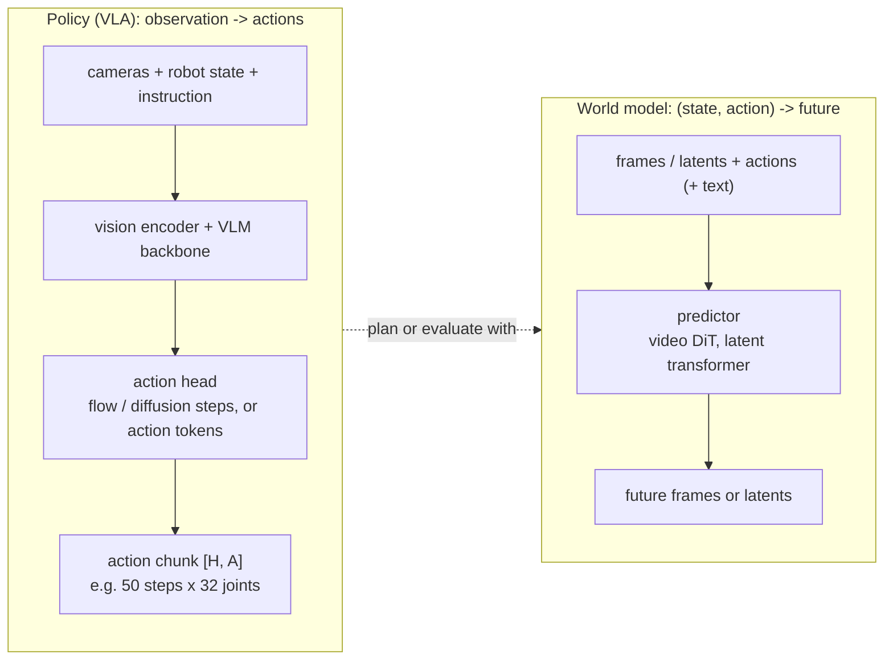
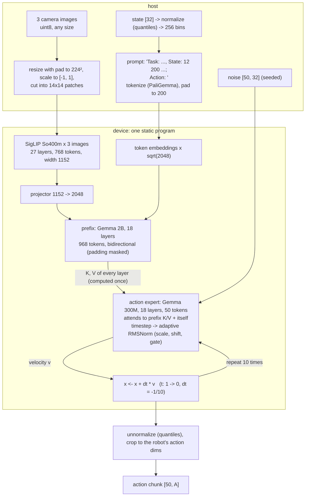
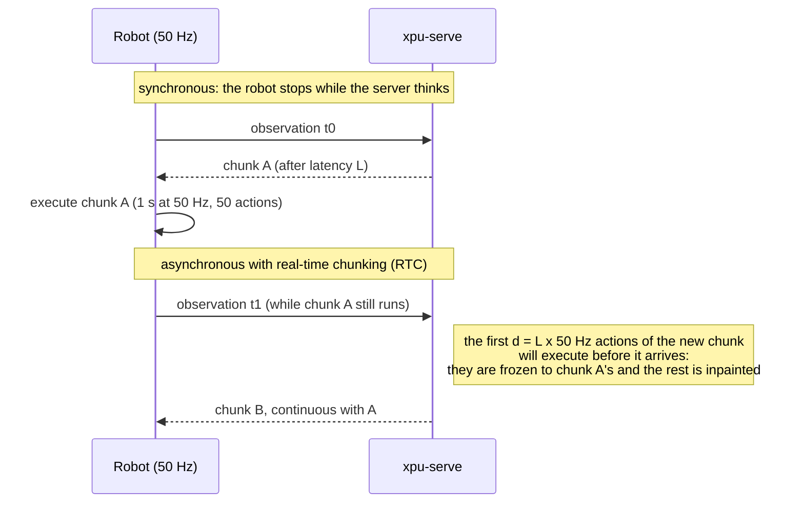
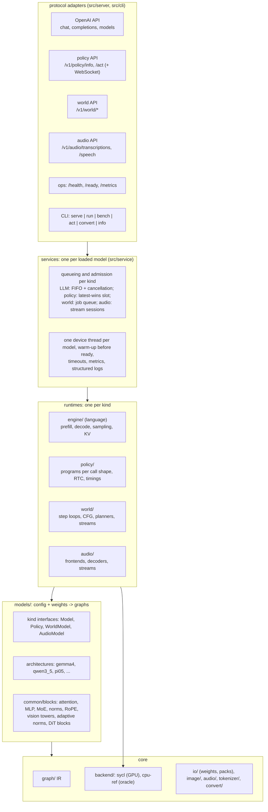
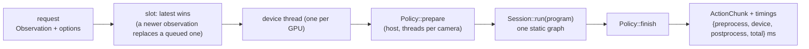

# Design: one serving platform for language, vision-language, robot-policy, world and audio models

Status: **approved** 2026-11-08 · first policy implemented and measured: π0.5 (`lerobot/pi05_base`, [section 6](#6-latency-measured-then-optimized))

xpu-serve started as an LLM / VLM engine. This document makes it a platform for every kind of model people now
deploy on Intel GPUs: language and vision-language models, robot policies (vision-language-action models, VLAs),
world models and, next, audio models. Part 1 analyzes what robot policies and world models are and what serving them
needs. Part 2 is the platform architecture (section 3) and the component changes (section 4). The guiding
requirement for robotics is **latency, not batching**: one robot, one observation, the action chunk back as fast and
as predictably as the hardware allows. There is no latency target until the models run: section 6 is a log of what
was measured and what each change bought.

---

## Part 1: Analysis

## 1. What these models are



- A **policy** maps an observation to robot actions. A **VLA** is a policy built on a pretrained vision-language
  model: the VLM reads the cameras and the instruction, and an action head turns its features into motor commands.
  The robot runs the commands at its control rate, typically 10 to 50 Hz, and asks for a new chunk before the current
  one runs out.
- A **world model** predicts what happens next: future video frames (Cosmos-Predict), future latent features
  (V-JEPA 2-AC), or an interactive stream that reacts to actions frame by frame (Matrix-Game). Robots use them to
  plan (search over candidate actions), to evaluate policies, and to generate training data.
- Newer **world-action models** do both: they predict future observations and actions jointly. At inference they
  are served as policies with extra outputs.

### 1.1 How they differ from what we serve today

| | LLM / VLM (today) | VLA policy | World model |
|---|---|---|---|
| Request | text (+ images) | 1 to 3 camera images, state vector, instruction | frames or latents, action sequence, (text) |
| Response | text tokens, streamed | one float tensor: an action chunk `[H, A]` | frames or latents |
| Inner loop | autoregressive decode, 1 token per step | 1 pass over the prefix, then **K denoising steps** of a small action expert (flow / diffusion), or a few action tokens | K denoising steps of a large DiT, or a planner's rollouts |
| State across requests | KV cache, prefix reuse | none (each observation is new); optionally the previous chunk for smooth handoff | none, or a streaming KV over past frames (interactive models) |
| Shapes | dynamic (prompt, output length) | **static**: fixed cameras, resolution, prompt budget, horizon | static per configuration |
| Metric | tokens/s, time to first token | **end-to-end latency and its jitter (p99)** | seconds per clip (offline), or frames/s (interactive) |
| Batching | helps throughput | batch 1; batching would only add latency | batches *inside* one request (CFG, planner candidates) |
| Numerics | lossy is fine if accuracy holds | small action errors move a real arm: **exact by default** | lossy usually acceptable |

### 1.2 The models

Open-weight models we want to be able to serve (status as of 2026-11; release details from the cited pages).

| Model | Params | Vision / backbone | Action head | Per call | What it needs from us |
|---|---|---|---|---|---|
| **π0.5** (Physical Intelligence; LeRobot port) | ~3.6 B | SigLIP So400m/14 + PaliGemma Gemma 2B | Gemma 300M action expert, **flow matching**, timestep through adaptive RMSNorm; state written into the prompt as 256-bin tokens | 3 cams 224², 200 text tokens, chunk 50 x 32, **10 Euler steps** | SigLIP tower, LayerNorm, joint two-stream attention, key padding mask, flow loop |
| π0 | ~3.3 B | same | same expert; timestep mixed into action tokens, continuous state token | same | as π0.5 |
| π0-FAST | ~3 B | PaliGemma | **autoregressive** FAST tokens (DCT + BPE) | ~30 to 60 decode steps | our LLM decode loop + an action detokenizer |
| SmolVLA (Hugging Face) | ~0.45 B | SmolVLM2, truncated | flow expert, interleaved cross- and self-attention | chunk 50, 10 steps | pixel shuffle, cross-attention |
| GR00T N1.6 / N1.7 (NVIDIA) | ~3 B | Cosmos-Reason-2B VLM | 32-layer **DiT**, flow matching, AdaLN; per-embodiment state/action MLPs | ~4 steps, horizon 8 to 16 | DiT block, AdaLN, embodiment selection |
| OpenVLA | 7 B | DINOv2 + SigLIP, Llama 2 | 7 autoregressive action tokens (256 bins) | 7 decode steps | LLM decode + bin detokenizer |
| OpenVLA-OFT | 7 B | same | parallel decoding, L1-regression MLP, chunks | 1 forward | bidirectional pass, MLP head |
| **World models** | | | | | |
| Cosmos-Predict2.5 (NVIDIA) | 2 B / 14 B | video VAE + reasoning-VLM text encoder | flow-matching **video DiT**; robot action-conditioned variant | tens of steps per clip (+ CFG) | Conv3d / GroupNorm / upsample (VAE), 3-D RoPE, AdaLN, cross-attention |
| V-JEPA 2 / 2.1-AC (Meta) | 1.2 B | ViT-g video encoder | latent action-conditioned predictor; planning by sampling (CEM) | hundreds of candidate rollouts | **batch axis** for candidates, block-causal frame mask |
| Matrix-Game 2.0 / 3.0 (Skywork) | 5 B (3.0) | causal video DiT (Wan-based) | few-step autoregressive frames with a **KV cache**, action per frame | streaming, per frame | stateful streaming session, causal VAE with conv state |

Takeaways:

1. **The flow-matching VLA is the dominant pattern** (π0, π0.5, SmolVLA, GR00T): a VLM prefix computed once per
   observation, then K cheap passes of a small action network that attends to the prefix. Designing for it first
   covers most of the field.
2. The **autoregressive VLAs** (π0-FAST, OpenVLA) are LLMs with an action detokenizer: our existing engine already
   runs them; they need a thin policy wrapper, not a new runtime.
3. **World models split three ways** (video generation, latent planning, interactive streaming) with very different
   needs: convolutions and big DiTs, intra-request batching, streaming state. They come after policies.

### 1.3 Anatomy of one π0.5 call



Approximate cost per call, and the speed-of-light (SOL) time on the Intel Arc Pro B60 discrete GPU. The B60 has
456 GB/s and 160 XMX engines. Intel rates it at 197 dense int8 TOPS; the ~98 TFLOPS f16 used here is half of that, a
third-party figure.

| Stage | Work | FLOPs | Weights read (f16) | Bound | SOL on B60 |
|---|---|---|---|---|---|
| Host preprocessing | 3 resizes, patchify, tokenize | — | — | CPU | 2 to 5 ms (parallelizable) |
| SigLIP x 3 | 768 tokens x 411 M params | 0.64 T | 0.8 GB | compute | ~6.5 ms |
| Prefix (Gemma 2B) | 968 tokens x 1.98 B params | 3.97 T | 4.0 GB | compute | ~40 ms |
| Action expert x 10 | 50 tokens x 311 M params, attention over 1018 keys | 0.38 T | 0.62 GB x 10 | **memory** | ~14 ms |
| **Total** | | **~5.0 T** | | | **~61 ms** |

Two different regimes inside one call: the prefix is a large compute-bound GEMM workload (like an LLM prefill), and
the denoising loop is ten small memory-bound passes (like ten decode steps of 50 tokens). Both must be fast.
Section 6 has the measured numbers.

### 1.4 The control loop: where latency matters



- Synchronous execution pauses the robot for the whole inference time at every chunk boundary.
- With **asynchronous execution** the client asks for the next chunk while the current one runs. Latency then
  sets how stale the observation is and how many actions are committed in advance (`d`). Physical Intelligence's
  **real-time chunking** (RTC) makes the handoff smooth by freezing the first `d` actions to the previous chunk and
  inpainting the rest during denoising. It needs no retraining. LeRobot ships two variants: "guided" (needs a
  vector-Jacobian product of the expert) and "trained" (a hard prefix).
- So the server must offer: **low and predictable latency**; an optional **previous chunk and delay** on each
  request (RTC); a **"latest observation wins"** queue (a stale observation is worse than none); and timings per
  request, so the client can measure `d`.

### 1.5 Requirements

| # | Requirement | Why |
|---|---|---|
| R1 | Observation in (named cameras, state vector, instruction), action chunk out, through one request | the robot client's contract |
| R2 | Latency first: batch 1, static shapes, no allocation or recompilation in steady state, warm-up at load | the metric is p50 / p99 latency |
| R3 | Exact by default: f16 compute with f32 accumulation matching the f32 reference (action cosine >= 0.99999 on fixed noise), deterministic run to run; anything lossy is opt-in and measured | a real arm moves on the output |
| R4 | Model-specific preprocessing in C++: resize with pad, normalization statistics (identity, mean/std, min/max, quantiles), state-in-prompt, tokenizer | a serving binary with no Python; reproducible |
| R5 | Seeded, or client-supplied, noise | reproducibility, tests, debugging a robot run |
| R6 | RTC: optional previous chunk + delay per request (hard-prefix inpainting first) | smooth asynchronous control |
| R7 | Timing per stage in every response, plus a latency benchmark (p50 / p90 / p99 / max, per-stage breakdown) | latency is the product |
| R8 | One model kind does not leak into another: the LLM path stays as it is | clean design |
| R9 | World models: big-DiT step loops, convolutional VAEs, intra-request batch (CFG, planner candidates), streaming state | later phases, but the design must leave room |

---

## Part 2: Design

## 2. Principles

1. **A model kind is a first-class concept.** xpu-serve serves *language models* (with images: VLMs), *policies*,
   *world models* and, next, *audio models*. Each kind has its own interface, its own small runtime and its own API
   surface. They share everything below that: the graph IR, the backends, weights and packs, preprocessing and the
   shared blocks.
2. **A policy call is one static program.** The model code builds a single graph for the whole call, from
   pixels to actions. The denoising loop is unrolled and the prefix K/V is just a value that every step reads. The
   result: one memory plan, no host round-trips between steps, no session state to manage, and a graph that the
   backend can record once and replay for every request. World models, whose steps are big, use host loops over a
   step graph instead.
3. **Latency over throughput.** Batch 1, fixed shapes, everything allocated and compiled at load, a warm-up run
   before the server says ready, one device thread per GPU, and the latest observation wins when requests pile up.
4. **Exact by default, opt-in to anything else**, with the same parity discipline as language models: a reference
   generator outside the binary, fixtures, stage-by-stage checks, planted-bug controls.
5. **Reuse before adding.** SigLIP, Gemma layers, attention, norms, RoPE and MLPs are `models/common` blocks
   already or become blocks. A new policy family should be mostly a config parser plus a graph built from blocks,
   like a new language model is today.

## 3. Platform architecture

### 3.1 Layers



| Layer | Owns | Knows nothing about |
|---|---|---|
| Protocol adapters | HTTP / WebSocket / CLI formats, request validation, error mapping | how a model computes |
| Services | one loaded model: its device thread, queue policy, admission, warm-up, readiness, metrics | wire formats |
| Runtimes | one kind's inference loop: prefill/decode, a policy program, a world model's step loop, an audio stream | HTTP, other kinds |
| Models | config parsing (refusals by name), the graphs of an architecture, host-side pre/post-processing | devices, queues |
| Blocks | math shared by architectures | checkpoint names |
| Graph IR | static op graphs with symbolic token / KV dims, state slots | models, devices |
| Backends | compiling and running a graph on a device: memory plans, kernels, fusions | models, kinds |

A new architecture is a folder under `models/` built from blocks; a new kind is an interface, a runtime, a service
and an adapter, nothing else changes. A new device is a backend.

### 3.2 Model kinds

| Kind | Input -> output | Inner loop | State across requests | Metric | Queue policy |
|---|---|---|---|---|---|
| Language (LLM, VLM) | text (+ images) -> text tokens, streamed | prefill, then decode steps | KV cache, prefix reuse | time to first token, tokens/s | FIFO, cancel on disconnect, batching later |
| Policy (VLA) | cameras + state + instruction -> action chunk | one static program (flow steps unrolled) | none (RTC: the previous chunk) | latency p50 / p99 | one slot, latest observation wins |
| World model | frames / latents + actions -> frames / latents | host loop over step graphs (CFG, planners) | streaming KV for interactive models | seconds per clip, or frames/s | job queue (offline), session (interactive) |
| Audio (next) | speech -> text (ASR); text -> speech (TTS); speech in a chat (audio LLM) | encoder + decoder steps; codec / vocoder for TTS | streaming encoder state | real-time factor, first-audio latency | stream sessions |

`model_kind(dir)` decides from the checkpoint's config (`model_type` for Hugging Face models, `type` for LeRobot
policies, later the world and audio layouts); `serve` mounts only that kind's API.

### 3.3 Production behaviour

- **Placement.** A process serves one model on one device by default. Multi-GPU boxes run one process per model
  and device (two robots on two B60s are two processes). A later multi-model process keeps one service per model,
  each with its own device thread; models never share a device thread, so a long LLM prefill cannot delay a policy
  call on another device.
- **Readiness.** Every service compiles its programs and runs a warm-up before `/ready` reports ready: kernels are
  compiled (JIT or ahead of time), oneMKL is initialized, memory is planned. Requests never pay first-run costs.
  For policies, warm-up covers every camera subset the deployment declares (or all of them).
- **Admission and backpressure.** Language models queue (bounded, `429` beyond); policies keep one pending slot
  where a newer observation replaces the queued one (a stale observation is worse than none); world-model jobs queue
  with a bound; audio streams are admitted while their real-time budget holds.
- **Failure handling.** Inputs are validated at the edge and refused by name (unknown camera, wrong state length,
  unsupported feature). A device error fails the request and marks the service unready until it recovers; the
  process does not limp on with a lost device.
- **Observability.** `/metrics` (Prometheus): request counts and latency histograms per kind and stage (prepare,
  device, finish for policies; prefill, decode for language models), queue depth, device memory. Every policy
  response also carries its own stage timings. Logs are structured (one line per request with its id and timings).
- **Reproducibility.** Seeds are explicit (policies return the seed they used; noise can be passed in), programs are
  deterministic run to run, and parity suites compare every model against its reference implementation.
- **Security.** Optional API key, no pickle or other code-carrying formats on the wire, request size limits.

## 4. Component changes

### 4.1 Graph IR (`src/graph`)

The IR stays a static op graph with symbolic `kT` / `kL`. What π0.5 needs:

| Change | Used by | Notes |
|---|---|---|
| `LayerNorm` op (with bias) | SigLIP, DiTs, most vision towers | today only RMSNorm |
| `Concat` op along an axis | prefix K/V + suffix K/V in the action expert; image + text embeddings | |
| Attention: optional **key mask** input `[L]` (valid / masked) | prompt padding to a fixed 200 tokens with static shapes | queries share one key mask, so one row covers bidirectional prefix + suffix |
| Attention: any head dim that is a multiple of 8 | SigLIP So400m has head dim 72 | today 16 to 512 from a fixed list |

Adaptive RMSNorm (`rms(x) * (1 + scale) + shift`, then a gated residual), the Euler update and RTC's frozen-prefix
blend are compositions of existing ops (`Mul`, `Add`, `Scale`, `Slice`). The timestep MLP depends only on `t`, so
the model folds it into per-step constants when it builds the graph.

Later, for world models: `Conv2d` / `Conv3d`, `GroupNorm`, nearest `Upsample`, 3-D RoPE (an axial RoPE with three
axes), block-causal attention masks, and a symbolic **batch dim `kB`** for intra-request batches (CFG, planner
candidates).

### 4.2 Shared blocks (`src/models/common`)

| Block | Built from | Reused by |
|---|---|---|
| `siglip_tower(spec, parts)`: patch embedding (a matmul over host-cut patches), learned positions, pre-LN encoder layers, optional pooling head | LayerNorm, attention (non-causal), GELU MLP | π0, π0.5, SmolVLA, PaliGemma-style VLMs |
| `gemma_layer(...)`: RMSNorm(1 + w), MQA / GQA attention, GeGLU | existing `attention`, `gated_mlp`, `rms_norm_one_plus` | PaliGemma backbone, π0 / π0.5 expert |
| `adaptive_rms_norm(x, scale, shift)` + `gated_residual` | RmsNorm, Mul, Add | π0.5 expert, DiT heads (AdaLN is the LayerNorm twin) |
| `joint_attention(prefix_kv, suffix, ...)`: queries of one stream over the K/V of both | Concat, attention with key mask | every "VLM + action expert" model |
| `flow_euler(x, v, dt)` and `rtc_blend(x, frozen, mask)` | Scale, Add, Mul | every flow-matching policy |

### 4.3 Models (`src/models`)

A policy interface next to the existing `Model` (which stays the language-model interface):

```cpp
// models/policy.h (as implemented)
struct CameraSpec { std::string name; int64_t height, width; };
struct PolicySpec {                 // what a client sends and gets back (GET /v1/policy/info)
    std::string id, arch;
    std::vector<CameraSpec> cameras;
    int64_t state_dim, action_dim, horizon, noise_dim;
    int denoise_steps;
};
struct Observation {                // any non-empty subset of the cameras
    std::vector<std::pair<std::string, image::Image>> cameras;
    std::vector<float> state;
    std::string instruction;
};
class Policy {
public:
    virtual const PolicySpec& spec() const = 0;
    virtual const WeightStore& weights() const = 0;
    // One static program per call shape: these cameras (ascending spec indices), this many flow steps.
    virtual graph::Graph build(const std::vector<int>& cameras, int steps) const = 0;
    virtual std::string prompt(const Observation& obs) const = 0;   // the runtime tokenizes it
    virtual int32_t prompt_bos() const = 0;
    virtual void prepare(const Observation& obs, const std::vector<int>& cameras, std::span<const int32_t> prompt_ids,
                         const HostTensor& noise, int steps, TensorMap& inputs) const = 0;
    virtual HostTensor finish(const TensorMap& outputs) const = 0;  // [horizon, action_dim], robot units
};
ModelKind model_kind(const std::filesystem::path& dir);            // Language or Policy (later World, Audio)
std::unique_ptr<Policy> load_policy(const std::filesystem::path& dir);
```

- `models/pi05/` holds `pi05_config.cpp` (LeRobot `config.json`, `policy_preprocessor.json` /
  `policy_postprocessor.json` and their normalization stats; refusals by name), `pi05_policy.cpp` (the graph, built
  from blocks) and `pi05_inputs.cpp` (the prompt format with state bins, the patches). π0 would sit next to it and
  share most of it.
- Normalization (`identity | mean_std | min_max | quantiles` per feature, from the checkpoint's stats) is generic
  and lives in `policy/normalize.{h,cpp}`. Resize-with-pad, the torch-exact variant LeRobot uses, joins `image/`.
- **Autoregressive policies** (π0-FAST, OpenVLA) implement `Policy` on top of a language model: `build()` returns
  nothing new, the runner calls the LLM engine's prefill and decode with constrained sampling, and `finish()`
  detokenizes (bins or FAST's inverse DCT). That is a later phase; the interface allows it.

### 4.4 Policy runtime (`src/policy`, new)



- `PolicyRunner`: owns the `Policy`, one compiled `Session` per `PolicyOptions` (usually one), the noise generator
  (Philox, seeded per request or per session) and the warm-up. `act(obs, options) -> ActionChunk`.
- `PolicyService`: a device thread and a one-slot queue with **latest-wins** (configurable to FIFO). The server
  talks to it, the same way the OpenAI server talks to `EngineService`.
- Timings come from host clocks around each stage and device timestamps inside the program. They are returned with
  every chunk.
- RTC: a request may carry `previous_actions` and `delay` (actions already committed). The runner turns them into
  the program's frozen-prefix inputs ("trained"-style hard prefix). Guided RTC needs a backward pass through the
  expert and is not planned.
- Nothing here knows about π0.5: the runtime sees `Policy`, `Session` and tensors.

### 4.5 Backends (`src/backend`)

The interface barely changes. A policy program is a stateless graph, like today's vision encoders. What changes is
how fast a static graph runs:

| Change | Expected effect | Status |
|---|---|---|
| **Record and replay**: plan once per shape, then record the program into a SYCL command graph (`sycl_ext_oneapi_graph`) and replay it per request | removes per-op host launch cost: a π0.5 program is ~5,000 ops (the expert alone is 10 steps x 18 layers), so a few µs each adds up to an estimated 15 to 25 ms | new; oneMKL calls inside a recording must be verified, with our own XMX GEMM as the fallback |
| **f16 activations** for GEMM-heavy regions (today activations are f32 and each GEMM input is converted to f16) | less memory traffic and no conversion kernels in the prefix | new backend mode, measured per model |
| GEMM shapes: M ≈ 768 to 968 (SigLIP, prefix) compute-bound; **M = 50** (expert) memory-bound | prefix near XMX peak; expert at bandwidth (split-K / weight-streaming kernel) | profile first: oneMKL, then custom kernels where it falls short |
| Fusions: QKV in one weight (concatenated at load), adaptive norm + modulation, residual + norm | fewer kernels and less activation traffic | uses the existing fusion pass |
| Attention: SigLIP head dim 72; bidirectional prefix with a key mask; expert queries over 1,018 keys | correct first, then fast | |
| Pinned host buffers for inputs and outputs, one host sync per request, optional spin-wait on completion | trims host overhead and wake-up jitter | |
| Determinism: one kernel choice per shape, ordered reductions (no atomics in split-K) | bit-identical repeats | test-enforced |

cpu-ref gets the new ops (LayerNorm, Concat, key mask, any head dim) and stays the f32 oracle.

### 4.6 Server and protocol (`src/server`)

| Endpoint | Body | Notes |
|---|---|---|
| `GET /v1/policy/info` | — | the `PolicySpec`: cameras (names, sizes), state and action dims, horizon, steps |
| `POST /v1/policy/act` | JSON (images base64 PNG / JPEG, or raw uint8 arrays) **or** msgpack with raw tensors (`Content-Type: application/msgpack`) | returns `{actions: [[...]], timing: {...}, seed}`; msgpack avoids base64 for 3 x 150 KB of pixels |
| `GET /v1/policy/ws` (proposed) | WebSocket, msgpack frames, **openpi policy-server protocol** | existing openpi clients and robot drivers connect unchanged; keeps one connection per robot |

Example request (JSON form):

```json
{
  "cameras": {"base_0_rgb": "<base64 PNG>", "left_wrist_0_rgb": "...", "right_wrist_0_rgb": "..."},
  "state": [0.12, -0.40, "...32 values"],
  "instruction": "pick up the red cup",
  "seed": 7,
  "previous_actions": [["...", "..."]], "delay": 5
}
```

Request validation fails by name: an unknown camera, a wrong state length, a missing instruction. LeRobot's async
inference speaks gRPC with pickled objects; we will not accept pickle (it executes code). The JSON or msgpack forms
cover its use, and a small client adapter can live outside the repo.

### 4.7 CLI (`src/cli`)

- `xpu-serve serve <policy-dir>` mounts the policy API, warms up, then prints ready.
- `xpu-serve bench <policy-dir> --steps 10` reports latency over N runs on synthetic or recorded observations:
  p50 / p90 / p99 / max, jitter, and the per-stage breakdown. This is the number for the first π0.5 milestone (3
  cameras 224², 10 steps, f16).
- `xpu-serve act <policy-dir> --image base=a.png,... --state ... --instruction ...` runs one call and prints the
  chunk, for debugging.

### 4.8 Convert and packs

LeRobot checkpoints are f32 (π0.5 base: 14.5 GB). They load as they are, and the backend uploads f16. `convert`
gains `--dtype f16` (no quantization) to write a 7 GB policy pack: faster loads, half the disk. The pack also carries
the policy's processor configs and stats. Quantized policies (q8 first) are opt-in and gated on action error, never
the default.

### 4.9 Tests

| Test | Against | Gate |
|---|---|---|
| Op tests: LayerNorm, Concat, attention key mask, head dim 72 (cpu-ref + device) | fp64 references | existing tolerances, planted-bug controls |
| Policy parity, stage by stage: patches, SigLIP output, prefix hidden states (layers 0 / 9 / 17), the velocity at each step, final actions | `tests/parity/policy/lerobot_reference.py`: LeRobot in f32 on CPU, fixed observation and noise, run outside the binary | cpu-ref ~1e-5; device f16 action cosine >= 0.99999 |
| Preprocessing: resize-with-pad, quantile normalization, prompt string and token ids | LeRobot's processors on the same inputs | exact |
| Determinism: the same request twice | itself | bit-identical actions |
| RTC: frozen actions come back as given; the rest are continuous with them | analytic | exact on the frozen part |
| Server: `/info`, `/act` (JSON and msgpack), refusals by name, latest-wins | fake `PolicyService` | |
| Latency: `bench` numbers in the PR and the decision record | — | reported (not asserted in CI) |

### 4.10 What does not change

The language-model engine, scheduler, chat, tokenizer and OpenAI server stay as they are. The graph IR keeps its
model: no control flow, no dynamic dispatch. The backend interface (`compile`, `run`) stays. Packs keep their
format.

## 5. Project structure after the change

```
src/
  graph/            + LayerNorm, Concat, attention key mask, any head dim (later: conv, group norm, kB)
  backend/          + record / replay, f16 activations, GEMM paths for the policy shapes
  models/
    model.h         language models (unchanged)
    policy.h        Policy, PolicySpec, Observation          (new)
    registry.cpp    load_model / load_policy: one place that knows every architecture
    common/         + siglip_tower, gemma_layer, adaptive_rms_norm, joint_attention, flow_euler, rtc_blend
    gemma4/ qwen3_5/
    pi05/           config, graph, inputs                     (new)
  policy/           PolicyRunner, PolicyService, normalize    (new)
  world/            world-model runtime: step loops, planners, streams   (later)
  audio/            audio decoding, resampling, log-mel; audio runtime   (later)
  engine/           LLM runtime (unchanged)
  image/            + resize_with_pad
  server/           + policy_handlers, msgpack codec (+ WebSocket)
  cli/              + act; bench and serve understand policies
tests/
  unit/model/policy_parity.cpp, unit/policy/*, unit/server/policy_*
  parity/policy/lerobot_reference.py
docs/decisions/0011-policy-runtime.md (after review)
```

## 6. Latency: measured, then optimized

No target was set in advance: the first measurement sets the baseline, a profile says where the time goes, and each
change is kept only if it pays and leaves the parity gates green. Setting: π0.5 base, 224x224 cameras, 10 flow steps,
f16, Intel Panther Lake (Arc B390 iGPU), steady state after warm-up (`xpu-serve bench`, 10 runs, p50; p90 within
1 % of p50 in every run so far).

| Change | 3 cameras | 2 cameras | 1 camera | Accuracy vs LeRobot f32 (max action error, 3 / 1 cameras) |
|---|---|---|---|---|
| First correct version (oneMKL GEMMs, per-op launches) | 428.5 ms | 325.9 ms | 253.7 ms | 1.1e-3 / 5.1e-4 |
| f16 GEMM inputs written by their producers; norm + shift and gated-residual fusions; no attention unpack with one KV head | 380.3 ms | | 227.1 ms | 1.1e-3 / 5.7e-4 |

Where the time goes now (per-op profile, ops run one at a time): the prefix MLP GEMMs (~92 ms), attention (~98 ms
across SigLIP, the prefix and the expert, mostly GEMM-path overhead and score traffic), the expert's GEMMs (~83 ms,
near their bandwidth floor of ~56 ms), and elementwise passes (bias adds, GeGLU) (~60 ms). Next steps in order of
expected gain: a fused attention kernel for the three shapes, the expert's K / V written in place instead of
concatenated per step, SigLIP attention batched across cameras, gate and up projections in one GEMM, bias adds folded
into their consumers, then record / replay of the whole program.

Missing cameras cost nothing: the program for a camera subset contains only those cameras, and its result equals
LeRobot's padded, masked cameras (the 1-camera parity case checks it).

Two GPUs in one box serve two robots, one per GPU. Splitting one call across two GPUs (tensor-parallel prefix) is out
of scope until the single-GPU path is tuned: PCIe all-reduces at every layer would eat most of the gain.

## 7. World models (later phases)

They plug into the same structure as a third kind: `models/world_model.h` (interface), `world/` (runtime) and
`/v1/world/*` (API).

| Class | Example | Runtime shape | New pieces |
|---|---|---|---|
| Video generation | Cosmos-Predict2.5 (2 B / 14 B), action-conditioned variant | encode context (VAE encoder, text encoder), host loop of K DiT steps (+ CFG), VAE decode | Conv2d / Conv3d, GroupNorm, Upsample, 3-D RoPE, AdaLN; a host step loop; seconds per clip, so throughput and memory matter more than latency |
| Latent planning | V-JEPA 2-AC | encoder once; planner (CEM) runs the predictor on N candidate action sequences per iteration | **batch dim `kB`** (candidates are one batched call), block-causal frame masks; the planner loop on the host |
| Interactive streaming | Matrix-Game 2.0 / 3.0 | a stateful session: each action yields the next frame chunk (few denoise steps over a KV cache of past frames), causal VAE decode with conv state | maps onto today's KV slots and conv-state slots; a streaming API (WebSocket); per-frame latency, the policy runtime's discipline |

I propose V-JEPA 2-AC or Matrix-Game as the first world model. Both are latency-shaped and reuse most of the
policy work. Cosmos-Predict needs the most new ops (the VAE) and is an offline workload.

### 7.1 Audio models (next)

| Class | Examples (open weights) | Runtime shape | New pieces |
|---|---|---|---|
| Speech recognition | Whisper-style encoder-decoders, Parakeet / Canary-style CTC / transducer models | log-mel frontend, conv + transformer encoder once per window, a decoder loop (the language engine's) | `audio/` (decode, resample, log-mel on the host), Conv1d, streaming encoder state for live audio |
| Speech synthesis | codec-token TTS (text -> discrete audio tokens -> codec decoder) | an LLM-style token loop, then a convolutional codec / vocoder | codec decoders (ConvTranspose1d, Snake / GELU blocks), streaming output (first audio before the last token) |
| Audio in a chat | omni models (an audio encoder in front of an LLM) | the VLM pattern with audio instead of images | an audio encoder graph, placeholder tokens like images |

Audio is a kind of its own (`AudioModel`, `audio/`, `/v1/audio/*`), with the language runtime reused for the token
loops. The metric is real time: first audio out and the real-time factor of a stream.

## 8. Decisions (reviewed 2026-11-08)

| # | Question | Outcome |
|---|---|---|
| 1 | Model kinds with their own interface, runtime and API, sharing graph, backends and blocks | approved; audio added as a fifth kind |
| 2 | One static program per policy call (flow steps unrolled, prefix K/V as a value) | approved; implemented |
| 3 | Prompt padded to the fixed 200 tokens with an attention key bias | approved; implemented (static shapes for every program) |
| 4 | Accuracy: f16 compute against the f32 reference on fixed noise; quantization opt-in only | approved; f16 matches LeRobot to 1e-3 on the actions |
| 5 | Protocol: HTTP JSON + msgpack first, an openpi-compatible WebSocket second | approved; not implemented yet |
| 6 | Tokenizer for `pi05_base` (PaliGemma's, a gated repository) | resolved: openpi's public SentencePiece model, converted; token ids match LeRobot's |
| 7 | First world model | open |
| 8 | Panther Lake as a target | measured there first (section 6); the B60 follows |
| — | Latency target | none until measured (reviewer); section 6 logs measurements instead |

## 9. References

- π0.5 in LeRobot: `lerobot/pi05_base` (config, processors), `src/lerobot/policies/pi05/` (modeling, processor).
- Physical Intelligence, *Real-Time Execution of Action Chunking Flow Policies* (arXiv 2506.07339) and the RTC blog post.
- SmolVLA (Hugging Face blog, arXiv 2506.01844); GR00T N1.6 model card and Isaac-GR00T repository.
- Cosmos-Predict2.5 (NVIDIA Cosmos repository and model page); V-JEPA 2 / 2.1 (Meta); Matrix-Game 2.0 (arXiv
  2508.13009) and Matrix-Game 3.0 (Skywork).
- Intel Arc Pro B60 datasheet (456 GB/s, 160 XMX engines, 197 int8 TOPS).
